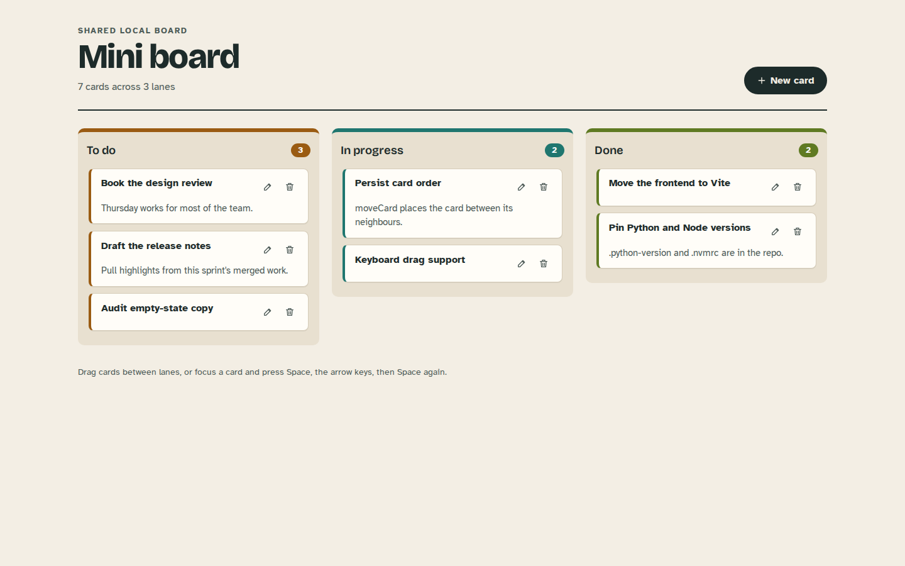
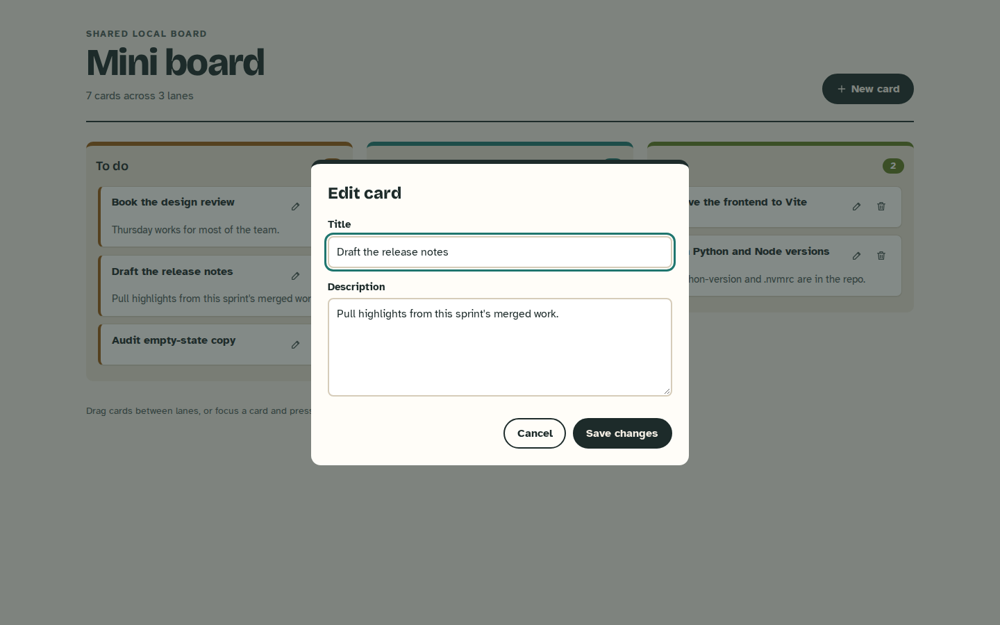
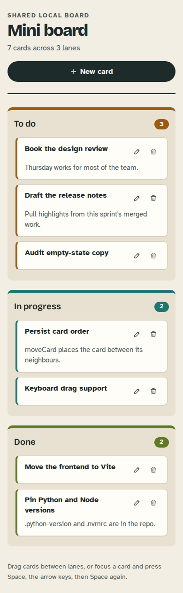
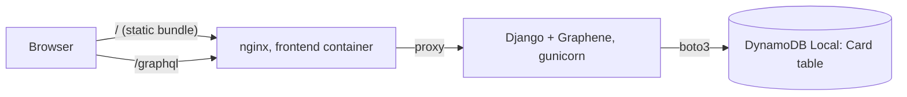

# Mini board

A small kanban board for one shared team space: three lanes (To do, In progress, Done), cards you can create, edit, delete and drag, and an order that survives a reload. The frontend is React, the API is Django serving GraphQL, and cards live in DynamoDB (DynamoDB Local in development).



It is deliberately small. There are no accounts and no per-board permissions: everyone who can reach the API sees and edits the same cards. That makes it a good local planning board or a compact example of GraphQL over DynamoDB, not a hosted multi-tenant service.

## Run it

You need Docker with Compose.

```sh
docker compose up --build
```

- Board: http://localhost:3000
- GraphQL API: http://localhost:8001/graphql (GraphiQL is served there while `DJANGO_DEBUG=1`)

DynamoDB Local runs in memory inside the stack, so cards disappear when its container is recreated. The API container creates the `Card` table on start (waiting for DynamoDB Local if needed) and leaves an existing table alone. The containers use placeholder AWS credentials that DynamoDB Local accepts; no AWS account is involved.

Optional settings go in a root `.env` file; see [`.env.example`](.env.example). With the default `DJANGO_DEBUG=1` the API generates a throwaway signing key per process. Set `DJANGO_DEBUG=0` together with a real `DJANGO_SECRET_KEY` for anything beyond local use.

## Using the board

- **New card** opens a form for a title (required, up to 200 characters), an optional description and the starting lane.
- Drag cards within a lane to reorder them or into another lane at any position. Keyboard users can focus a card, press Space to lift it, move it with the arrow keys and press Space again to drop it.
- The pencil button edits a card; the bin deletes it after a confirmation.
- If the API is unreachable the board says so and offers a retry. A failed move puts the cards back in their saved order and shows a message.



<p align="center"></p>

## How it fits together



The browser only ever talks to its own origin. nginx serves the built bundle and forwards `/graphql` to the API, and the Vite dev server does the same in development, so the frontend needs no CORS setup or hard-coded API host. The API still allows `http://localhost:3000` through django-cors-headers for direct calls; change it with `CORS_ALLOWED_ORIGINS`.

### Card order

Each card stores a numeric `position`. New cards go to the end of their lane (last position + 1024). `moveCard(cardId, status, index)` takes the lane and the slot the card was dropped into. The server looks up the neighbours at that slot and gives the card the midpoint of their positions, so a move writes one item. When two neighbours get too close to split (after many moves into the same gap), the lane is renumbered first. `allCards` returns cards lane by lane in position order.

Cards saved before positions existed have none; they sort to the top of their lane and pick up a position the first time they are moved.

### Why DynamoDB without Django models

Cards are plain DynamoDB items behind a small `Card` class in `boards/models.py`. Django only provides the HTTP layer and settings, so there is no SQL database, admin or user model. Writes that must not create items use condition expressions: updating an unknown card id fails with "Card not found" instead of creating a partial card.

## GraphQL API

These were captured from the running stack. A card:

```graphql
type CardType { id: String, title: String, description: String, status: String, position: Float }
```

Statuses are `todo`, `in-progress` and `done`.

Create a card (it goes to the end of its lane):

```sh
curl -s http://localhost:8001/graphql -H 'Content-Type: application/json' -d '{
  "query": "mutation($title: String!, $description: String, $status: String) { createCard(title: $title, description: $description, status: $status) { card { id title status position } } }",
  "variables": {"title": "Draft the release notes", "description": "Pull highlights from this sprint'"'"'s merged work.", "status": "todo"}
}'
```

```json
{"data": {"createCard": {"card": {"id": "7d3541b2-d032-47c4-aa7f-52cf7377b425", "title": "Draft the release notes", "status": "todo", "position": 1024}}}}
```

Move a card to the top of the To do lane (`index` is the slot, 0 = top):

```graphql
mutation { moveCard(cardId: "1b05d7b1-a03f-44ff-9141-15a391ad43f9", status: "todo", index: 0) { card { title status position } } }
```

```json
{"data": {"moveCard": {"card": {"title": "Book the design review", "status": "todo", "position": 0}}}}
```

Read the board, lane by lane in order:

```graphql
{ allCards { title status position } }
```

```json
{"data": {"allCards": [
  {"title": "Book the design review", "status": "todo", "position": 0},
  {"title": "Draft the release notes", "status": "todo", "position": 1024},
  {"title": "Audit empty-state copy", "status": "todo", "position": 2048},
  {"title": "Persist card order", "status": "in-progress", "position": 1024},
  {"title": "Keyboard drag support", "status": "in-progress", "position": 2048},
  {"title": "Move the frontend to Vite", "status": "done", "position": 1024},
  {"title": "Pin Python and Node versions", "status": "done", "position": 2048}
]}}
```

Invalid input comes back as a GraphQL error and nothing is stored:

```graphql
mutation { createCard(title: "   ") { card { id } } }
```

```json
{"errors": [{"message": "A card needs a title", "locations": [{"line": 1, "column": 12}], "path": ["createCard"]}], "data": {"createCard": null}}
```

Also available: `card(id: ID!)` returns one card or `null`, `updateCard(cardId, title, description, status)` edits text (a changed status appends the card to that lane), and `deleteCard(cardId)` returns `success: false` when the card did not exist.

## Development

The runtimes are pinned: Python 3.12 (`mini_trello_be/.python-version`) and Node 22.12 or newer (`mini_trello_fe/.nvmrc`, `engines`).

Backend, from `mini_trello_be/`:

```sh
python -m venv .venv && . .venv/bin/activate
pip install -r requirements-dev.txt
ruff check . && ruff format --check .
python manage.py test tests
```

The tests use [moto](https://github.com/getmoto/moto) as an in-memory DynamoDB, so they need neither Docker nor network access. They cover ordering and renumbering, cross-lane moves, the conditional update, scan pagination, validation, the table bootstrap and the HTTP endpoint, including CORS.

To run the API outside Docker, start DynamoDB Local (`docker run -p 127.0.0.1:8000:8000 amazon/dynamodb-local:3.3.0`), then `python -m boards.dynamodb_setup` and `python manage.py runserver 8001`. Set `AWS_ACCESS_KEY_ID` and `AWS_SECRET_ACCESS_KEY` to any placeholder value if none are configured.

Frontend, from `mini_trello_fe/`:

```sh
npm ci
npm run dev      # http://localhost:3000, proxies /graphql to localhost:8001
npm test         # Vitest + Testing Library
npm run lint
npm run build
```

`API_PROXY_TARGET` changes where the dev server forwards `/graphql`, and `VITE_GRAPHQL_URL` points the built app at a different endpoint.

## Limits

- No authentication or per-board ownership. The GraphQL view is CSRF-exempt because it uses no cookies or sessions. Put it behind authentication before exposing it anywhere shared.
- `allCards` scans the whole table and returns every card. That is fine for a team board and wrong for thousands of cards.
- Moves are last-writer-wins. Two people dragging in the same lane at the same moment can end up with an order neither intended, though no card is lost.
- The nginx and gunicorn containers are suitable for a local or internal deployment; there is no TLS, and DynamoDB Local is not persistent storage.

## License

MIT, see [LICENSE](LICENSE).
